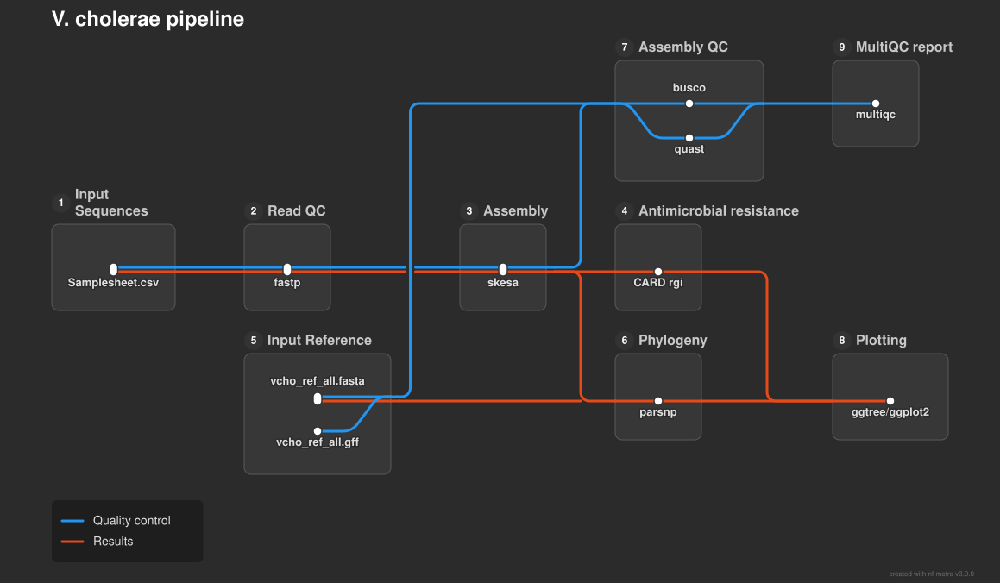
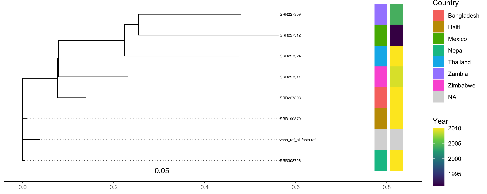
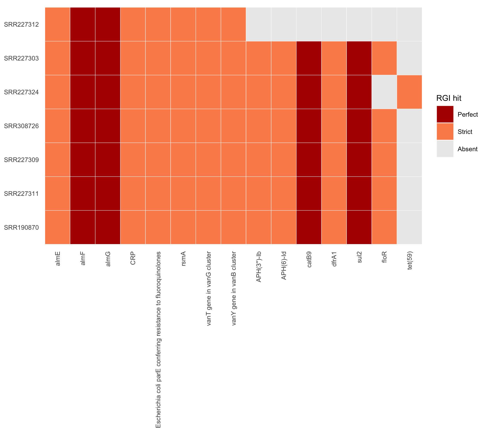

# Genomic Epidemiology of the 2010 Haiti Cholera Outbreak
 
## Table of Contents
 
- [Project Background](#project-background)
- [Design Rationale and Summary](#design-rationale-and-summary)
- [DAG](#dag)
- [Data Explanation](#data-explanation)
- [Core Dependencies](#core-dependencies)
- [Instructions](#instructions)
- [Expected Results](#expected-results)
- [Directory Structure Overview](#directory-structure-overview)
- [Gen AI Use Statement](#gen-ai-use-statement)
## Project Background
 
For much of human history, epidemics have been poorly understood. Not much was known about their transmission patterns, or which cases could be confidently considered related. The advent of Next Generation Sequencing has changed that. We now know that within what seems like a large outbreak exist multiple nucleotide-level differences that can link seemingly unrelated samples.
 
So how do we genomically define an infectious disease outbreak? How can we determine transmission dynamics? Genomic epidemiology seeks to answer these questions using bioinformatic techniques.
 
While these techniques can be applied to any infectious disease, this particular project focuses on *Vibrio cholerae*, a water-borne pathogen.
 
> **Fun fact:** *V. cholerae* was the subject of the first effective epidemiological map, constructed by John Snow in 1854 and used to trace the source of an outbreak to a contaminated well pump in London.
>
> **Not-so-fun fact:** *V. cholerae* has caused roughly seven major pandemics since 1817 (the seventh is still ongoing), and causes an estimated 95,000 deaths annually worldwide.
 
In January 2010, Haiti was hit by an earthquake and received international aid in the form of food, water, and aid workers. In October 2010, Haiti confirmed a cholera outbreak. Though initial studies indicated that the Haitian outbreak strain was related to strains from South Asia, Bangladesh, or Mozambique, a genomic epidemiological investigation by Hendriksen et al. showed that Nepalese aid workers were the likely point of entry. Genomic evidence combined with other evidence (such as the position of the Nepalese campsites) confirmed that Nepal was indeed the likely source.
 
The investigation by Hendriksen et al. was limited by the technologies of the time. Their approach was to align sample reads to a known *V. cholerae* reference genome and construct a maximum parsimony tree. We now know that significant differences between bacterial samples exist in the accessory genome, and only manifest in *de novo* assembly, not reference alignment. Furthermore, maximum parsimony has been largely replaced by maximum likelihood.
 
**If we redo the 2010 analysis using modern bioinformatic tools, can we expect to see the same results?**
 
## Design Rationale and Summary
 
> **Note:** This pipeline was designed with historical data in mind (paired-end short-read sequencing). Modern high-quality assembly prefers using both short and long reads (see Ryan Wick's blog for more!).
 
### Input
 
- `samplesheet.csv`: sample country and date metadata, SRR accession, and (optionally) `fastq1` and `fastq2` file addresses
- *V. cholerae* reference genome FASTA and GFF files (used for QUAST and Parsnp, but **not** for reference alignment)
### Tools
 
| Step | Tool | Rationale |
|------|------|-----------|
| Raw read QC | fastp | Chosen for its versatility |
| Short-read *de novo* assembly | SKESA | Selected for its accuracy over SPAdes |
| Assembly completeness and contamination QC | BUSCO | Standard completeness/contamination metric |
| General assembly QC | QUAST | General assembly QC metric reporter |
| Core genome phylogeny | Parsnp | Performs multiple sequence alignment to find regions present in all samples, then constructs a maximum likelihood tree |
| Resistance gene profiling | CARD RGI | Extracts a resistance gene profile for each sample. ABRicate, which references several AMR gene databases, would have been preferred, but was not possible due to space limitations. The decision to use CARD over other databases in this pipeline was completely informed and I totally did not just choose it because it's Canadian. |
| Visualization | ggplot2, ggtree (R) | Plotting trees and heatmaps |
 
### Output (found in results/r_plots)
 
- Phylogenetic tree overlaid with country and sampling date metadata
- Antimicrobial resistance gene presence/absence heatmap
## DAG
 

 
## Data Explanation
 
Data was taken from XXX, originally containing >150 global samples of *V. cholerae*. Single-end samples were filtered out, and a single representative for each country was selected.
 
## Core Dependencies
 
This pipeline was tested on ARM64 architecture, but is expected to work on AMD64 as well. Most modules can be run on ARM64 by emulating their Docker images. The exceptions are SKESA and the R environment, both of which use conda instead.
 
- [Docker](https://www.docker.com/)
- [Nextflow](https://www.nextflow.io/)
- [Conda](https://docs.conda.io/)
## Instructions
 
In the project directory, run:
 
```bash
nextflow run .
```
 
That's all! The pipeline will download the necessary environments, samples, and databases during its first run.
 
## Expected Results

(If using default samplesheet.csv)
 



 
## Directory Structure Overview
 
```
BIOF_501A_project/
├── assets/                  # Static pipeline files (e.g. helper scripts, schemas, templates)
├── conf/                    # Configuration files (module-specific settings, profiles)
├── databases/               # Reference databases used by pipeline modules
├── inputs/                  # Input data (e.g. sample sheet, accession list)
├── modules/                 # Process definitions for each tool (e.g. SKESA, Parsnp)
├── results/                 # Pipeline outputs (generated)
├── subworkflows/
├── work/                    # Nextflow working directory with intermediate files (generated)
├── main.nf                  # Main workflow script
├── modules.json             # nf-core module/subworkflow version tracking
├── nextflow.config          # Global pipeline configuration
└── README.md                # Project documentation
```
 
## Gen AI Use Statement
 
- All analysis, ideas, and tool choices were made by Ryan Choi.
- Code was also originally written by Ryan Choi, but tidied up with Claude afterwards.
 
